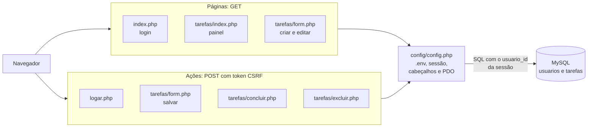

<p align="center">
  <picture>
    <source media="(max-width: 767px)" srcset="https://raw.githubusercontent.com/IsaacGomes260653/Sistema-de-Gerenciamento-de-Tarefas/main/.github/banner-mobile.svg">
    
  </picture>
</p>

<p align="center">
  <b>Lista de tarefas em PHP e MySQL com login, em que cada pessoa só vê, edita e apaga as próprias tarefas.</b><br>
  Para quem estuda PHP sem framework e quer ver senha com bcrypt, token CSRF e consultas filtradas pelo dono funcionando juntos.<br>
  <a href="#demonstração"><b>Ver a demonstração</b></a> · não há site no ar: o app roda no seu computador, com PHP e MySQL
</p>

<p align="center">
  <a href="LICENSE"></a>
  <a href="https://github.com/IsaacGomes260653/Sistema-de-Gerenciamento-de-Tarefas/commits/main"></a>
  
</p>

<p align="center">
  <a href="#demonstração">Demonstração</a> ·
  <a href="#como-rodar-em-60-segundos">Como rodar</a> ·
  <a href="#o-que-ele-faz">O que ele faz</a> ·
  <a href="#como-foi-feito">Como foi feito</a> ·
  <a href="#testes-e-qualidade">Testes e qualidade</a> ·
  <a href="#próximos-passos">Próximos passos</a> ·
  <a href="#english-summary">English</a>
</p>

## Demonstração

<p align="center">
  
</p>

Gravado com o Playwright, com o app rodando localmente (`php -S`, PHP 8.4 e MariaDB 11.8) e tarefas de exemplo.

No celular, a tabela vira uma lista de cartões. No tema claro e no escuro:

<p align="center">
  
  
</p>

## Como rodar em 60 segundos

Precisa do Git, do PHP 8.1 ou mais novo (com as extensões `pdo_mysql` e `mbstring`) e de um MySQL ou MariaDB ligado na porta 3306. O [XAMPP](https://www.apachefriends.org/) traz tudo isso junto.

```bash
git clone https://github.com/IsaacGomes260653/Sistema-de-Gerenciamento-de-Tarefas.git
cd Sistema-de-Gerenciamento-de-Tarefas/SGT
cp .env.example .env
mysql -u root -p -e "source banco.sql"
php database/seed.php
php -S localhost:8000
```

Abra <http://localhost:8000> e entre com o usuário `admin` e a senha `123456`. Num clone limpo, do `git clone` até a tela de login no ar, levou cerca de 2 segundos (Windows 11, PHP 8.4 e MariaDB 11.8). Também conferi no PHP 8.1.

- Os mesmos comandos funcionam no Git Bash, no PowerShell e no terminal do macOS e do Linux. O `source` dentro do `mysql` evita o `<`, que o PowerShell não aceita.
- O `-p` pede a senha do MySQL. No XAMPP, o `root` vem sem senha: é só apertar Enter. Se o seu tem senha, ponha ela também no `DB_PASS` do `.env`.
- No XAMPP do Windows, `php` e `mysql` ficam em `C:\xampp\php\` e `C:\xampp\mysql\bin\` e nem sempre estão no PATH. Dá também para pular o `php -S`: copie a pasta `SGT` para `C:\xampp\htdocs\` e abra <http://localhost/SGT>. Os links se ajustam sozinhos à subpasta.
- Sem o `.env`, o app usa os mesmos valores do `.env.example`: `localhost`, banco `tarefas`, usuário `root` sem senha.
- Se aparecer "Não foi possível conectar ao banco de dados", o MySQL está desligado, a senha está errada ou falta o `pdo_mysql` no PHP (confira com `php -m`). O motivo exato sai no terminal do `php -S`.
- Não há tela de cadastro: o `seed.php` cria só o `admin`. Para testar com uma segunda pessoa, gere o hash da senha com `php -r "echo password_hash('outra123', PASSWORD_DEFAULT);"`, entre no banco com `mysql -u root -p tarefas` e, já dentro dele, rode `INSERT INTO usuarios (usuario, senha) VALUES ('maria', 'o hash gerado');`. Cole o hash no prompt do `mysql`, e não num comando do terminal: ele tem vários `$`, que o Bash e o PowerShell tentariam trocar por variáveis.

## O que ele faz

- **Login com usuário e senha.** A senha é conferida com `password_verify` contra o hash bcrypt guardado no banco. O botão de olho mostra e esconde o que foi digitado. Errou, aparece "Usuário ou senha incorretos."; depois de cinco erros seguidos, o login fica bloqueado por um minuto.
- **Painel com três contadores:** total de tarefas, pendentes e concluídas, contados no servidor a cada carregamento.
- **Criar e editar.** Título obrigatório (até 255 caracteres), descrição opcional (até 2000, com contador ao vivo) e status Pendente ou Concluída. A validação é feita no servidor, e o erro aparece embaixo do campo. Pela edição, uma tarefa concluída pode voltar a ser pendente.
- **Concluir com um clique.** O botão de concluir só aparece nas pendentes.
- **Excluir com confirmação.** Uma janela própria, com o título da tarefa, pergunta antes de apagar. Ela fecha com Cancelar, com Esc ou com um clique fora.
- **Busca e filtro sem recarregar a página.** A busca olha o título e a descrição, sem diferença entre maiúsculas e minúsculas, e os filtros separam Todas, Pendentes e Concluídas. Se nada combina, aparece "Nada encontrado".
- **Aviso depois de cada ação** ("Tarefa criada com sucesso.", "Tarefa excluída."), que some sozinho em 4,5 segundos ou no X.
- **Tema claro e escuro.** Na primeira visita, segue o tema do sistema. O botão troca, e a escolha fica salva no navegador.
- **Celular.** Abaixo de 760 px de largura, a tabela vira cartões, com os mesmos botões.

### Segurança

O que mais trabalhei neste projeto foi garantir que uma pessoa logada não consiga mexer nas tarefas de outra.

- **O dono está em todas as consultas.** Todo SQL de tarefa usa o `usuario_id` da sessão, nunca um que venha do formulário: no `WHERE` de quem lista, abre para editar, salva, conclui e exclui, e no `INSERT` de quem cria. Uma tarefa de outra pessoa recebe a mesma resposta de uma que não existe: "Tarefa não encontrada."
- **Token CSRF em todo formulário que muda algo:** login, criar, editar, concluir e excluir. Sem o token certo, a resposta é o status 419.
- **Concluir e excluir só por POST.** Um GET nessas rotas só volta para o painel.
- **Consultas preparadas** com PDO e a emulação desligada, então o valor nunca é colado no texto do SQL.
- **Saída escapada.** Tudo o que vai para a página passa pela função `e()`, que usa o `htmlspecialchars`.
- **Sessão protegida.** Cookie `HttpOnly` e `SameSite=Lax` (e `Secure` quando há HTTPS), id da sessão trocado no login e cookie apagado no logout.
- **Cabeçalhos** `X-Frame-Options: DENY`, `X-Content-Type-Options: nosniff` e `Referrer-Policy`.
- **Senha do banco fora do Git.** As credenciais ficam no `.env`, que está no `.gitignore`. Com `APP_ENV` diferente de `local`, os erros vão para `storage/php-error.log` e não aparecem na tela.

## Como foi feito

| Escolha | Por quê |
|---|---|
| PHP 8.1 ou mais novo, sem framework | São três telas e quatro ações. Cada página é um arquivo `.php` que começa incluindo o `config/config.php`, então dá para seguir um pedido do começo ao fim sem camadas no meio. O 8.1 é o mínimo por causa do tipo `never` no `redirect()`. |
| MySQL ou MariaDB, pelo PDO | Consultas preparadas, erro como exceção e uma chave estrangeira com `ON DELETE CASCADE`: apagar um usuário apaga as tarefas dele. O índice em `(usuario_id, status)` atende o filtro que toda consulta faz. |
| Sessões do próprio PHP | O login não precisa de biblioteca: quem está logado é o `usuario_id` guardado na sessão. |
| `.env` lido pelo `config/env.php` | São 32 linhas no lugar do Composer, então não há dependência nenhuma para instalar. |
| CSS próprio, com variáveis no `tokens.css` | Cores, espaços, cantos e tempos de animação ficam num arquivo só. O tema escuro só troca as variáveis, e as animações quase somem com o `prefers-reduced-motion`. |
| JavaScript sem biblioteca (`app.js`) | Tema, avisos, janela de confirmação, contador, mostrar a senha, busca e filtro. A lista já vem inteira do servidor, então filtrar no navegador é instantâneo. |
| Ícones em SVG no `icons.php` | Sem fonte de ícones e sem pedido a outro servidor. A cor segue o texto (`currentColor`). |
| Plus Jakarta Sans, do Google Fonts | É a única coisa que vem de fora. Sem internet, a página usa a fonte do sistema. |



Cada ação confere o token, grava no banco filtrando pelo dono, guarda um aviso na sessão e redireciona para o painel. O painel mostra o aviso uma vez e o apaga. Como toda ação termina num redirecionamento, recarregar a página depois de salvar não cria a tarefa de novo.

### Decisões técnicas e o que eu aprendi

- **De onde ele veio.** A primeira versão, de maio de 2026, guardava a senha em MD5, gerada pelo próprio `banco.sql`, e o `excluir.php` apagava por GET qualquer id (`DELETE FROM tarefas WHERE id = :id`), sem olhar de quem era. Logado, bastava trocar o número na URL para apagar a tarefa de outra pessoa. Em setembro reescrevi o projeto em cima desses dois problemas.
- **O hash da senha sai do PHP.** O `MD5('123456')` saiu do `banco.sql`. O `admin` agora é criado pelo `database/seed.php` com o `password_hash`, porque o bcrypt não existe no SQL.
- **A checagem fica na consulta, não na tela.** Esconder um botão não protege nada. O que protege é o `usuario_id` no `WHERE`, e por isso testei com um segundo usuário tentando abrir, editar, concluir e excluir as tarefas do primeiro.
- **O endereço base é calculado.** O `config.php` compara a pasta do app com o `DOCUMENT_ROOT` do servidor e monta o `BASE_URL`. O mesmo código funciona em `http://localhost:8000` e em `http://localhost/SGT`.
- **O tema não pisca.** Um script curto no `<head>` lê o tema salvo (ou o do sistema) antes de a página ser desenhada. Sem ele, quem usa o tema escuro veria um clarão branco a cada página.
- **Duas listas, um filtro.** O PHP gera a tabela do computador e os cartões do celular ao mesmo tempo, a partir de `_task-row.php` e `_task-card.php`, e o CSS mostra uma das duas. A busca e o filtro passam pelas duas, com o mesmo atributo `data-task-row`.
- **Uma janela própria no lugar do `confirm()`.** O envio do formulário de excluir é segurado até a confirmação, e aí o `requestSubmit()` envia de verdade. O botão só mostra "Salvando…" nesse segundo envio, e não enquanto a janela ainda está aberta.
- **O bloqueio do login tem limite.** As tentativas são contadas na sessão. Isso atrapalha quem erra a senha no navegador, mas quem apaga o cookie recomeça do zero. Testei, e ficou nos próximos passos.

<details>
<summary>Estrutura de pastas</summary>

```
.
├── SGT/                          # o app
│   ├── index.php                 # tela de login
│   ├── logar.php                 # confere a senha, o token e as tentativas
│   ├── logout.php                # apaga a sessão e o cookie
│   ├── banco.sql                 # cria o banco tarefas e as tabelas usuarios e tarefas
│   ├── .env.example              # credenciais do banco e APP_ENV
│   ├── config/
│   │   ├── config.php            # incluído por toda página: sessão, cabeçalhos e BASE_URL
│   │   ├── database.php          # conexão PDO
│   │   └── env.php               # leitor do .env
│   ├── database/
│   │   └── seed.php              # cria o usuário admin com a senha em bcrypt
│   ├── includes/
│   │   ├── auth.php              # require_login() e o usuário da sessão
│   │   ├── csrf.php              # gera e confere o token
│   │   ├── helpers.php           # e(), redirect() e os avisos
│   │   ├── icons.php             # ícones em SVG
│   │   └── partials/             # head, barra do topo, avisos, janela de confirmação e scripts
│   ├── tarefas/
│   │   ├── index.php             # painel: contadores, busca, filtros e a lista
│   │   ├── form.php              # criar e editar
│   │   ├── concluir.php          # POST: marca como concluída
│   │   ├── excluir.php           # POST: apaga
│   │   └── _task-row.php e _task-card.php   # uma tarefa na tabela e no cartão
│   ├── assets/
│   │   ├── css/                  # tokens, base, componentes, login e painel
│   │   ├── js/app.js             # tudo o que roda no navegador
│   │   └── img/favicon.svg
│   └── storage/                  # log de erros fora do ambiente local
├── LICENSE
└── .github/
    ├── banner.svg, banner-mobile.svg e social-preview.png
    └── capturas/                 # GIF e capturas deste README
```

</details>

## Testes e qualidade

O projeto não tem testes automatizados, lint nem CI. Para este README, conferi tudo a partir de um clone limpo, no terminal e no Chromium, com o Playwright:

- `php -l` nos 22 arquivos PHP, no PHP 8.1 e no 8.4, sem erro;
- login certo, senha errada e o bloqueio depois de cinco tentativas;
- criar, editar, concluir e excluir, com a confirmação, os avisos e os contadores; o título vazio é recusado;
- busca, filtros e o tema claro e escuro;
- isolamento entre usuários: logado como um segundo usuário, abrir pela URL, editar, concluir e excluir tarefas do `admin` deu "Tarefa não encontrada." nas quatro tentativas, e o banco continuou igual;
- CSRF: um POST sem o token recebe 419, e um GET no `excluir.php` só volta para o painel;
- os cabeçalhos de segurança e o cookie de sessão `HttpOnly` e `SameSite=Lax`;
- o painel numa tela de 390 px, nos dois temas, e o app numa subpasta, como no XAMPP;
- nenhum erro no console.

Nessa revisão apareceram os problemas que abrem a lista de próximos passos.
