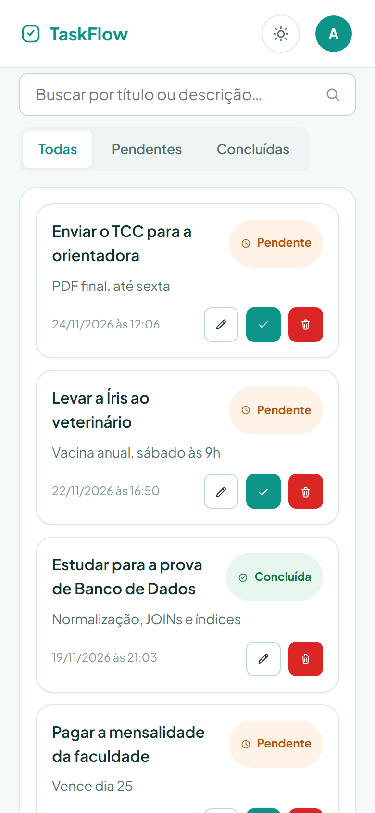
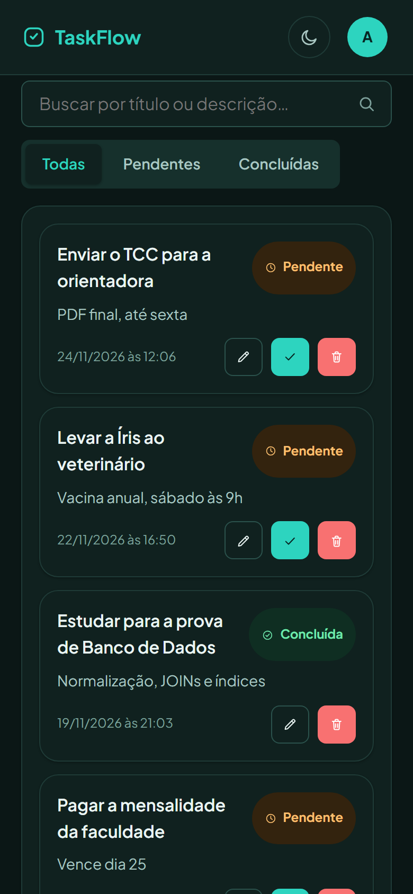

<p align="center">
  <picture>
    <source media="(max-width: 767px)" srcset="https://raw.githubusercontent.com/IsaacGomes260653/Sistema-de-Gerenciamento-de-Tarefas/main/.github/banner-mobile.svg">
    
  </picture>
</p>

<p align="center">
  <b>Lista de tarefas em PHP e MySQL com login, em que cada pessoa só vê, edita e apaga as próprias tarefas.</b><br>
  Para quem estuda PHP sem framework e quer ver senha com bcrypt, token CSRF e consultas filtradas pelo dono funcionando juntos.<br>
  <a href="#demonstração"><b>Ver a demonstração</b></a> · não há site no ar: o app roda no seu computador, com PHP e MySQL
</p>

<p align="center">
  <a href="LICENSE"></a>
  <a href="https://github.com/IsaacGomes260653/Sistema-de-Gerenciamento-de-Tarefas/commits/main"></a>
  
</p>

<p align="center">
  <a href="#demonstração">Demonstração</a> ·
  <a href="#como-rodar-em-60-segundos">Como rodar</a> ·
  <a href="#o-que-ele-faz">O que ele faz</a> ·
  <a href="#como-foi-feito">Como foi feito</a> ·
  <a href="#testes-e-qualidade">Testes e qualidade</a> ·
  <a href="#próximos-passos">Próximos passos</a> ·
  <a href="#english-summary">English</a>
</p>

## Demonstração

<p align="center">
  
</p>

Gravado com o Playwright, com o app rodando localmente (`php -S`, PHP 8.4 e MariaDB 11.8) e tarefas de exemplo.

No celular, a tabela vira uma lista de cartões. No tema claro e no escuro:

<p align="center">
  
  
</p>

## Como rodar em 60 segundos

Precisa do Git, do PHP 8.1 ou mais novo (com as extensões `pdo_mysql` e `mbstring`) e de um MySQL ou MariaDB ligado na porta 3306. O [XAMPP](https://www.apachefriends.org/) traz tudo isso junto.

```bash
git clone https://github.com/IsaacGomes260653/Sistema-de-Gerenciamento-de-Tarefas.git
cd Sistema-de-Gerenciamento-de-Tarefas/SGT
cp .env.example .env
mysql -u root -p -e "source banco.sql"
php database/seed.php
php -S localhost:8000
```

Abra <http://localhost:8000> e entre com o usuário `admin` e a senha `123456`. Num clone limpo, do `git clone` até a tela de login no ar, levou cerca de 2 segundos (Windows 11, PHP 8.4 e MariaDB 11.8). Também conferi no PHP 8.1.

- Os mesmos comandos funcionam no Git Bash, no PowerShell e no terminal do macOS e do Linux. O `source` dentro do `mysql` evita o `<`, que o PowerShell não aceita.
- O `-p` pede a senha do MySQL. No XAMPP, o `root` vem sem senha: é só apertar Enter. Se o seu tem senha, ponha ela também no `DB_PASS` do `.env`.
- No XAMPP do Windows, `php` e `mysql` ficam em `C:\xampp\php\` e `C:\xampp\mysql\bin\` e nem sempre estão no PATH. Dá também para pular o `php -S`: copie a pasta `SGT` para `C:\xampp\htdocs\` e abra <http://localhost/SGT>. Os links se ajustam sozinhos à subpasta.
- Sem o `.env`, o app usa os mesmos valores do `.env.example`: `localhost`, banco `tarefas`, usuário `root` sem senha.
- Se aparecer "Não foi possível conectar ao banco de dados", o MySQL está desligado, a senha está errada ou falta o `pdo_mysql` no PHP (confira com `php -m`). O motivo exato sai no terminal do `php -S`.
- Não há tela de cadastro: o `seed.php` cria só o `admin`. Para testar com uma segunda pessoa, gere o hash da senha com `php -r "echo password_hash('outra123', PASSWORD_DEFAULT);"`, entre no banco com `mysql -u root -p tarefas` e, já dentro dele, rode `INSERT INTO usuarios (usuario, senha) VALUES ('maria', 'o hash gerado');`. Cole o hash no prompt do `mysql`, e não num comando do terminal: ele tem vários `$`, que o Bash e o PowerShell tentariam trocar por variáveis.
